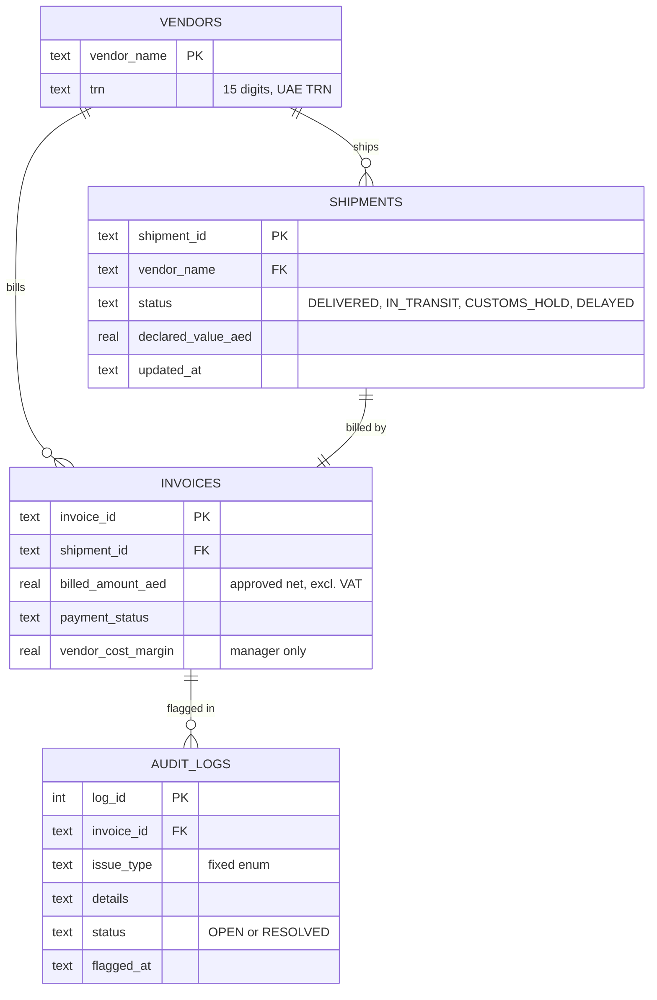
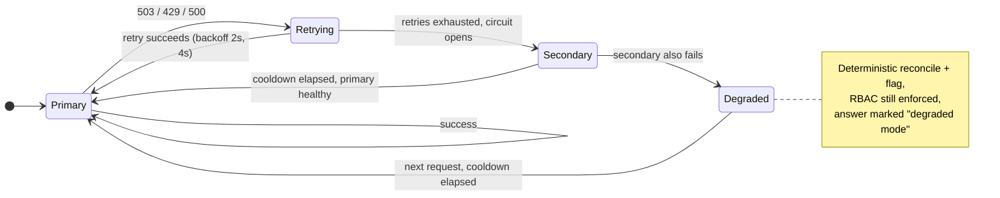
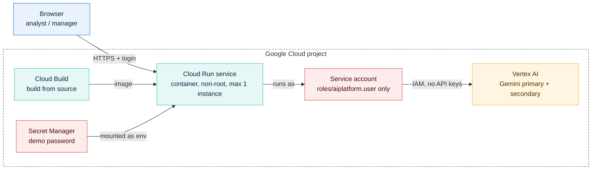

# Architecture deep dive

*Enterprise Ops & Invoice Reconciliation Copilot · by [Shridhar Ch](https://shrichinta.github.io)*

## 1. Data model
The ERP is the system of record for approved (net) amounts. Vendor PDFs are untrusted evidence.

The audit log enforces idempotency **in the database**, not in application code:
```sql
CREATE UNIQUE INDEX ux_audit_open ON audit_logs(invoice_id, issue_type) WHERE status = 'OPEN';
```

## 2. Model resilience: circuit breaker
A pinned, pre-approved primary and secondary model. If both are unavailable, the system degrades to deterministic audits instead of failing.


## 3. Target deployment (scripts included: `Dockerfile`, `deploy.sh`)

| Control | Implementation |
|---|---|
| Identity to Vertex AI | service account with `roles/aiplatform.user`; no API keys in the container |
| Secrets | Secret Manager, mounted as env at runtime |
| Container | non-root user, minimal `python:3.12-slim` image |
| Cost guardrail | `max-instances 1`, `min-instances 0`, budget alert |

## 4. Design decisions
| Decision | Why |
|---|---|
| Arithmetic in code, not the LLM | auditable and repeatable; the LLM can't hallucinate a variance |
| Role bound server-side, not a tool argument | a prompt injection can't escalate privileges |
| Allow-list RBAC, not deny-list | new sensitive columns stay hidden by default |
| Evidence gate on the write tool | the model can only flag what a deterministic check found |
| Lexical + exact-ID retrieval before embeddings | invoice IDs and 15-digit TRNs are where pure vector search misses |
| Degraded mode + nightly batch | the business process doesn't depend on LLM availability |
| Tools exposed over MCP | the model provider is swappable (Gemini, Azure OpenAI, Claude) for data-residency needs |

## 5. Known limits of this build
| Area | This build | For a real client |
|---|---|---|
| Database | SQLite, synthetic data | Cloud SQL / Postgres or the client's ERP via read-only API |
| Auth | Gradio login + secret | SSO (Entra ID / Google) via Identity-Aware Proxy; role from token claims |
| Retrieval | BM25 + exact-ID filters | add dense vectors with RRF fusion for free-text questions |
| Capacity | on-demand model access | provisioned throughput + agreed SLA |

<sub>© 2026 Shridhar Ch · All rights reserved. Viewing permitted; reuse requires written permission.</sub>
